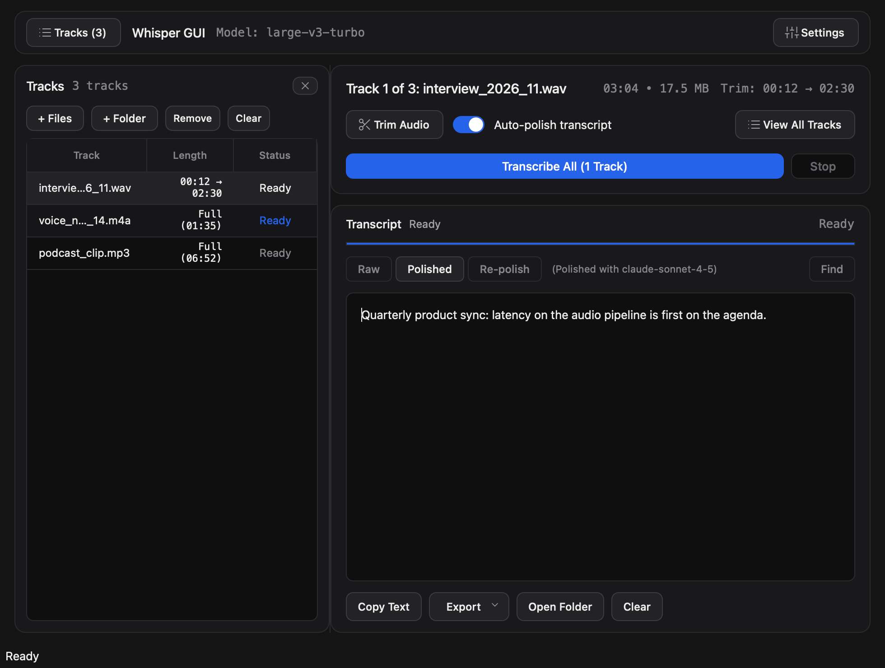
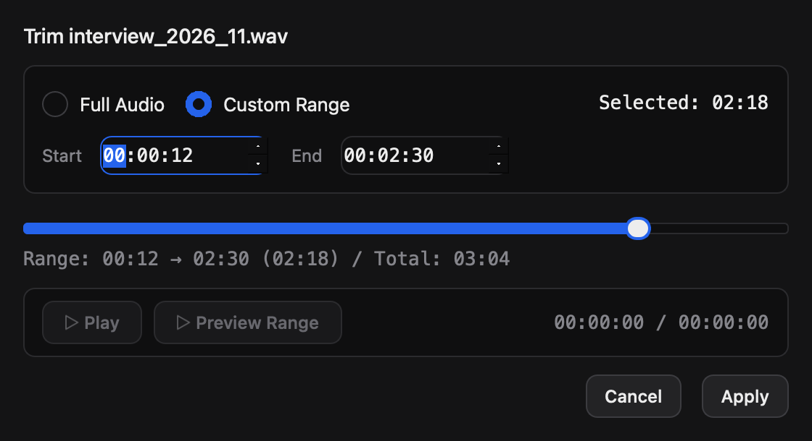
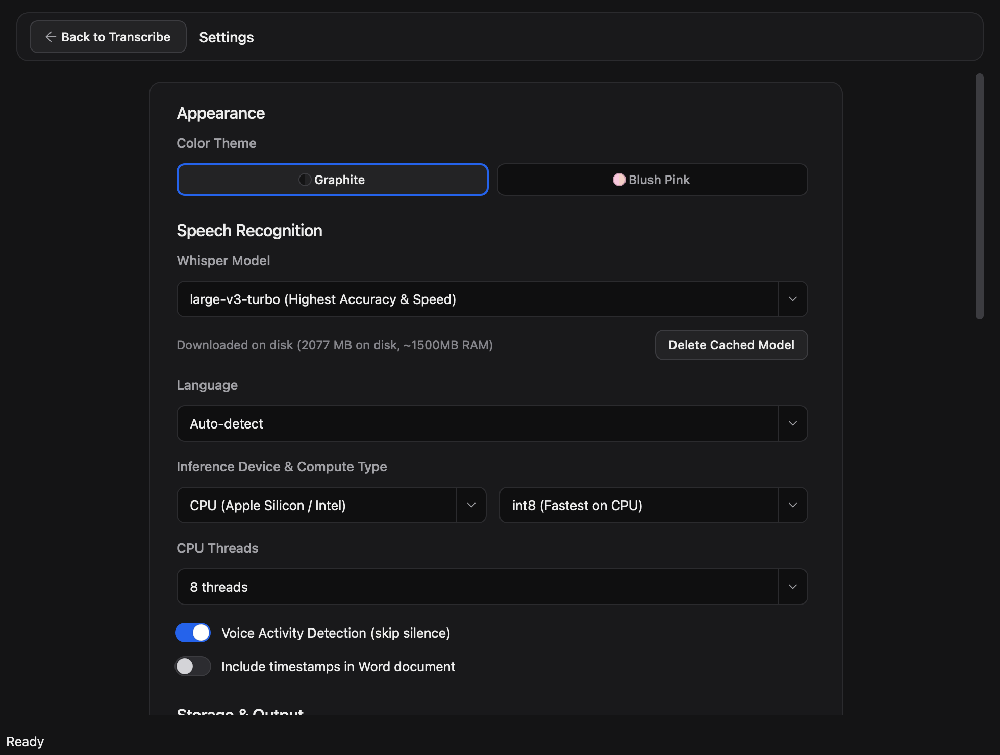

<p align="center">
  
</p>

<h1 align="center">Whisper GUI</h1>

<p align="center">
  Offline desktop audio transcription with a multi-track queue, FFmpeg range trimming, six export formats, and optional LLM polishing.
</p>

<p align="center">
  
  
  
  
</p>

---

## Preview

### Workspace & Multi-Track Drawer
Queue multiple files, switch per-track transcripts, edit text inline, search with `Ctrl/Cmd+F`, and export to `.docx`, `.pdf`, `.md`, `.txt`, `.srt`, or `.vtt`.



### Audio Trimming
Select exact `HH:MM:SS` start and end timestamps and preview playback before transcribing without modifying the source file.

<p align="center">
  
</p>

### Settings & Appearance
Switch between **Graphite** and **Blush Pink** themes, configure Whisper models and hardware options, and manage optional LLM post-processing.



---

## Capabilities

- **Offline Speech Recognition**: Runs locally on CPU (`macOS` Apple Silicon / Intel, `Windows`, `Linux`) or NVIDIA CUDA (`Windows`, `Linux`) via `faster-whisper` (CTranslate2). Audio never leaves your machine unless you enable optional LLM text polishing.
- **Multi-Track Queue**: Import files or folders across 13 formats (`.mp3`, `.wav`, `.m4a`, `.aac`, `.flac`, `.ogg`, `.opus`, `.wma`, `.mp4`, `.mkv`, `.webm`, `.mov`, `.avi`) and process them sequentially.
- **FFmpeg Trimming & Preview**: Slice custom time ranges with built-in audio playback before running Whisper.
- **Six Export Formats & Inline Editing**: Edit transcripts in place, search within the viewer, and export to Microsoft Word (`.docx`), PDF (`.pdf`), Markdown (`.md`), plain text (`.txt`), SubRip (`.srt`), and WebVTT (`.vtt`).
- **Optional LLM Polishing**: Remove verbal fillers and fix punctuation using **DeepSeek**, **Anthropic (Claude)**, **OpenAI**, **Groq**, or any custom OpenAI-compatible URL (including local **Ollama**) with editable Markdown prompts.
- **Themes, Memory Controls & Auto-Updates**: Toggle between **Graphite** (dark) and **Blush Pink** (light) themes, unload or delete cached models from disk, and check GitHub Releases for updates.

---

## Quick Start

Download packaged builds from [GitHub Releases](https://github.com/ySimoz/whisper-gui/releases), or run from source using the platform scripts (requires **Python 3.10+** and **FFmpeg** on `PATH`).

### macOS
```bash
git clone https://github.com/ySimoz/whisper-gui.git
cd whisper-gui
./run_macos.sh
```

### Windows
```cmd
git clone https://github.com/ySimoz/whisper-gui.git
cd whisper-gui
run_windows.bat
```

### Linux
```bash
git clone https://github.com/ySimoz/whisper-gui.git
cd whisper-gui
./run_linux.sh
```

---

## Architecture

```
PySide6 UI (MainWindow • TrackListWidget • TranscriptView • SettingsPageWidget • TrimAudioDialog)
   │
   ▼ QThread signals / slots
Background Workers (TranscriptionWorker • PolishWorker)
   │                                       │
   ▼                                       ▼
audio_utils.py (ffmpeg / ffprobe)     transcriber.py (faster-whisper / CTranslate2)
   │                                       │
   └───────────────────┬───────────────────┘
                       ▼
Export & Post-Processing (docx_exporter.py • exporters.py • llm_cleaner.py)
```

- **UI Layer**: Two-page `QStackedWidget` navigation in `MainWindow` with focused modal dialogs (`TrimAudioDialog`, `InstructionEditorDialog`, `UpdateDialog`) and live theme switching via [theme.py](src/whisper_gui/ui/theme.py).
- **Audio Pipeline**: Invokes `ffmpeg` and `ffprobe` directly with `shell=False` and cross-platform process termination (`taskkill` on Windows, `killpg` on POSIX).
- **Transcription & Polishing**: `TranscriptionWorker` and `PolishWorker` run on `QThread` so progress updates, cancellation, and multi-track queuing keep the interface responsive.
- **Zero-SDK HTTP & Exports**: `llm_cleaner.py` uses Python's `urllib` with `certifi` TLS roots; exports use `python-docx` for `.docx` and Qt/stdlib writers for `.pdf`, `.md`, `.txt`, `.srt`, and `.vtt`.

---

## Development & Testing

```bash
python3 -m venv .venv
source .venv/bin/activate  # Windows: .venv\Scripts\activate

pip install -e ".[dev]"
QT_QPA_PLATFORM=offscreen pytest -v
```

---

## Standalone Packaging

Build a local desktop bundle without requiring a system Python installation at runtime:

```bash
pip install pyinstaller
python scripts/bundle_app.py
```

Outputs `dist/WhisperGUI.app` on macOS, `dist/WhisperGUI/WhisperGUI.exe` on Windows, and `dist/WhisperGUI/WhisperGUI` on Linux. Release tags (`v*`) also trigger automated cross-platform builds via GitHub Actions.

---

## Data & Storage Locations

Configuration and cached models stay outside the application bundle so updates preserve settings:

| Data | Windows | macOS | Linux |
|---|---|---|---|
| **Settings** (`QSettings`, incl. theme) | `HKCU\Software\WhisperGUI\WhisperAudioTranscriber` | `~/Library/Preferences/com.whispergui.WhisperAudioTranscriber.plist` | `~/.config/WhisperGUI/WhisperAudioTranscriber.conf` |
| **LLM API Key** | Windows DPAPI (`LLM/api_key_dpapi`) | macOS Keychain (`WhisperGUI` / `llm_api_key`) | `secret-tool` (`QSettings` fallback) |
| **Whisper Models** (`HF_HUB_CACHE`) | `%USERPROFILE%\.cache\huggingface\hub\` | `~/.cache/huggingface/hub/` | `~/.cache/huggingface/hub/` |
| **Temp Slices & Updates** | `%TEMP%` | `$TMPDIR` | `/tmp` |
| **Transcripts** | Source audio folder (or custom output directory) | Source audio folder (or custom output directory) | Source audio folder (or custom output directory) |

LLM API keys are stored in OS credential storage on macOS, Windows, and Linux (`secret-tool`), migrating any legacy plain-text key automatically on load.

---

## License

MIT License. See [LICENSE](LICENSE).
