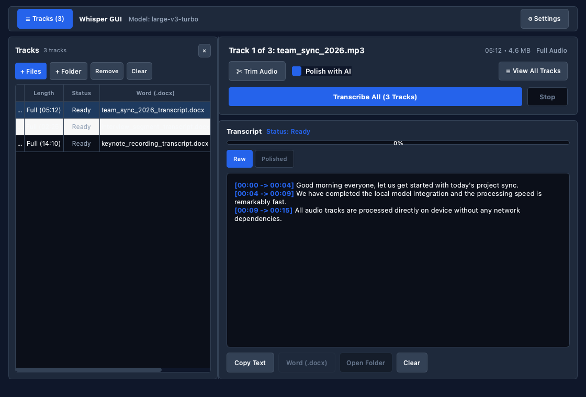
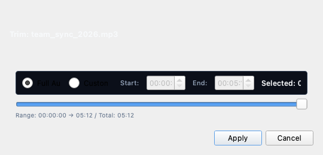
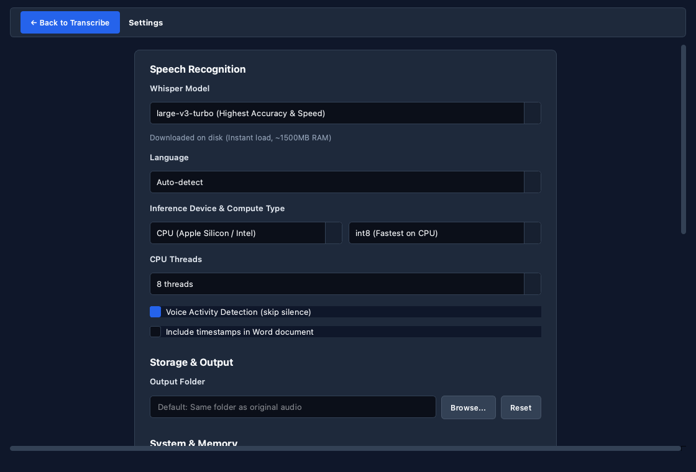

<p align="center">
  
</p>

<h1 align="center">Whisper GUI</h1>

<p align="center">
  <strong>Fast, private, local audio transcription with multi-track queue, audio trimming, and Microsoft Word export.</strong>
</p>

<p align="center">
  
  
  
  
  
</p>

---

## Overview

**Whisper GUI** is a desktop application designed to transcribe lectures, meetings, podcasts, and interviews directly on your machine. All speech recognition executes 100% offline using `faster-whisper` (CTranslate2)—audio files never leave your computer.

---

## Workflow Preview

### 1. Workspace & Multi-Track Lateral Drawer
The slide-out drawer keeps your audio queue organized with live progress pills, one-click track activation, and batch processing:



---

### 2. Audio Trimming
Frame-accurate range selection with Start/End markers to transcribe only the sections you need:

<p align="center">
  
</p>

---

### 3. Dedicated Settings
Sequential, uncompressed configuration for Whisper models, inference hardware, CPU thread allocation, and optional speech polishing:



---

## Features

- **100% Offline & Private**: Speech recognition runs entirely on your local hardware (Apple Silicon NEON, Intel AVX2, or NVIDIA CUDA). Audio never leaves your device.
- **Lateral Tracks Drawer**: Slide-out sidebar to manage multiple audio files, check per-track statuses, and trigger one-click batch transcription.
- **Audio Trimming (FFmpeg)**: Set precise start and end timestamps (`HH:MM:SS`) to transcribe specific excerpts without re-encoding or modifying the original media.
- **Microsoft Word (.docx) Export**: Automatically creates formatted Word documents with timestamps, metadata headers, and styled paragraph structure.
- **RAM-Conscious Model Management**: Pre-configured with `large-v3-turbo` for optimal speed and accuracy, with live memory indicators and a 1-click **Unload Model** button to free RAM immediately.
- **Speech Polishing (Optional)**: Optionally cleans verbal fillers ("umms", "uhs", unintentional repetitions) into readable prose using your own custom prompt instructions.
- **Broad Format Support**: Transcribes `.mp3`, `.wav`, `.m4a`, `.aac`, `.flac`, `.ogg`, `.opus`, `.wma`, `.mp4`, `.mkv`, `.webm`, and `.mov`.

---

## 1-Click Launchers

Run Whisper GUI on any machine with automated virtualenv setup and dependency installation:

### macOS (Apple Silicon & Intel)
```bash
git clone https://github.com/ySimoz/whisper-gui.git
cd whisper-gui
./run_macos.sh
```

### Windows
```cmd
git clone https://github.com/ySimoz/whisper-gui.git
cd whisper-gui
run_windows.bat
```

### Linux (Ubuntu / Debian / Fedora)
```bash
git clone https://github.com/ySimoz/whisper-gui.git
cd whisper-gui
./run_linux.sh
```

---

## Architecture & Technical Stack

```
┌─────────────────────────────────────────────────────────────┐
│                    PySide6 (Qt 6) UI                        │
│  MainWindow  •  TracksDrawer  •  SettingsPage  •  TrimView  │
└──────────────────────────────┬──────────────────────────────┘
                               │ Signals / Slots
┌──────────────────────────────▼──────────────────────────────┐
│             Background Worker (QThread Pipeline)            │
│  - Progress tracking  •  Cancellation token  •  Process IPC │
└──────────────┬──────────────────────────────┬───────────────┘
               │                              │
┌──────────────▼──────────────┐┌──────────────▼───────────────┐
│   FFmpeg Audio Subprocess   ││ faster-whisper (CTranslate2) │
│ - 16kHz mono WAV extraction ││ - large-v3-turbo / int8      │
│ - Frame-accurate slicing    ││ - Local offline inference    │
└──────────────┬──────────────┘└──────────────┬───────────────┘
               │                              │
┌──────────────▼──────────────────────────────▼───────────────┐
│                    Export & Post-Process                    │
│  python-docx (.docx builder)  •  Optional LLM Speech Polish │
└─────────────────────────────────────────────────────────────┘
```

- **Frontend Architecture**: Written in **PySide6 (Qt 6)** with a single-window design. The navigation uses `QStackedWidget` to eliminate confusing modal dialogs.
- **Inference Engine**: Powered by **faster-whisper** (CTranslate2 engine), achieving up to 4x faster transcription than vanilla Whisper with significantly lower memory usage.
- **Audio Pipeline**: Non-blocking **FFmpeg** execution via isolated subprocess argument vectors (`shell=False`), preventing shell injection and supporting graceful tree termination (`taskkill` on Windows, `killpg` on POSIX).
- **Process Isolation**: Slicing and transcription tasks execute in dedicated background threads to keep the user interface fluid and responsive at all times.
- **Document Exporter**: Pure Python document generation via **python-docx**, outputting clean typography, metadata headers, and styled paragraph spacing.

---

## Development & Testing

```bash
# Set up development virtual environment
python3 -m venv .venv
source .venv/bin/activate  # On Windows: .venv\Scripts\activate

# Install package with development dependencies
pip install -e ".[dev]"

# Run full test suite (47 unit & integration tests)
pytest -v
```

---

## Standalone Distribution

To compile a native executable that runs without requiring Python installed:

```bash
pip install pyinstaller
python scripts/bundle_app.py
```

- **macOS**: Generates `dist/WhisperGUI.app`
- **Windows**: Generates `dist/WhisperGUI/WhisperGUI.exe`
- **Linux**: Generates `dist/WhisperGUI/WhisperGUI`

Standalone binaries are also compiled automatically across all three operating systems via GitHub Actions on every release tag.

---

## License

MIT License. See [LICENSE](LICENSE) for details.
